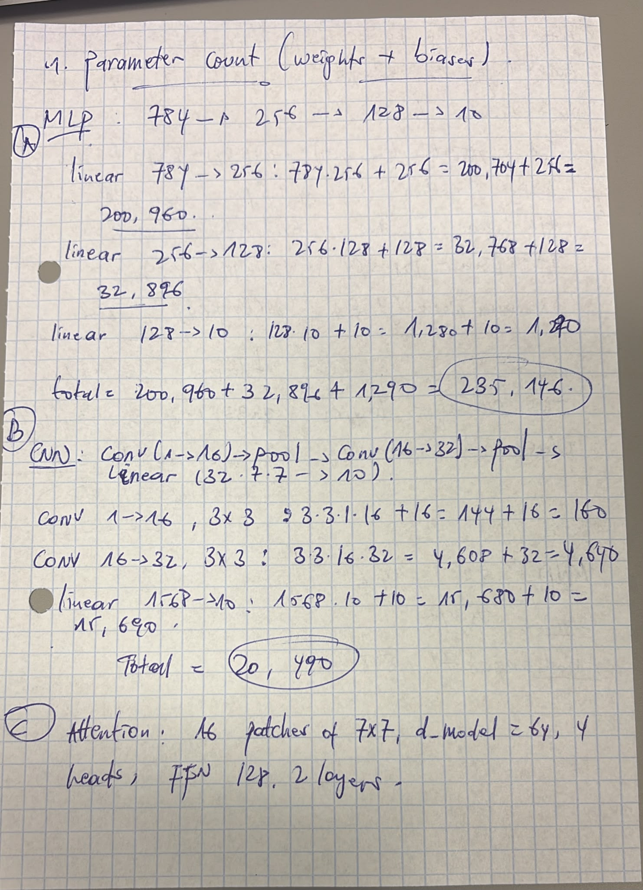
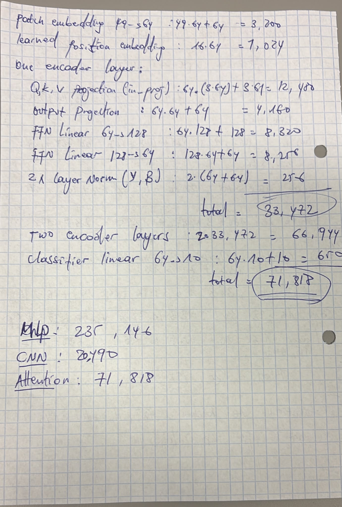
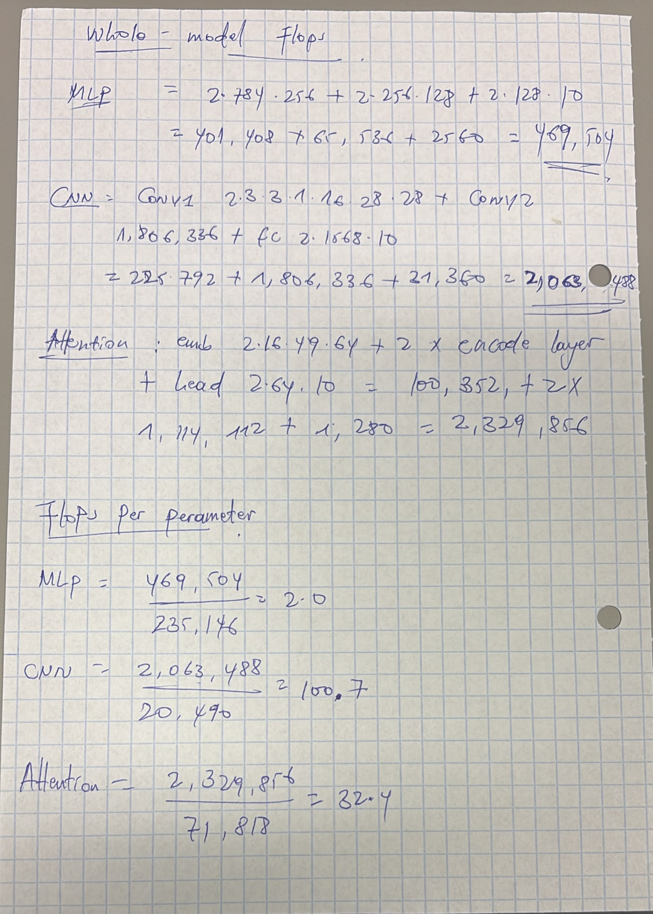
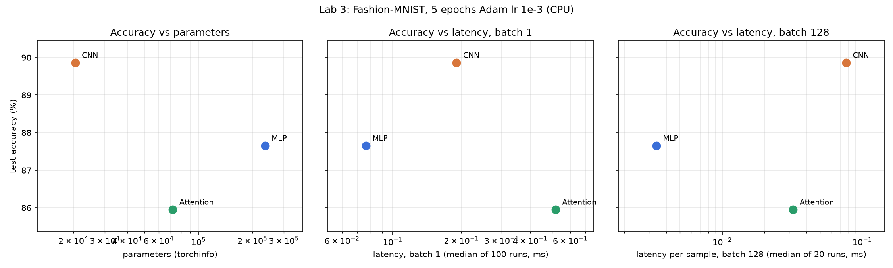

# Lab 3 — Architectures and their costs

Fashion-MNIST, three architectures (MLP, CNN, patch attention), PyTorch 2.3.1 on CPU (4 threads).

```bash
python lab03/src/run_all.py      # or the task*.py scripts one by one, from lab03/src
```

| File | Content |
|---|---|
| `src/common.py`, `src/models.py` | data split/loaders, the three models |
| `src/task1_dataset.py` … `src/task5_plots.py` | one script per task |
| `results/` | CSV outputs, `torchinfo_summary.txt`, `training_output.txt`, `tradeoffs.png` |

## 1. Dataset

`torchvision.datasets.FashionMNIST`, `ToTensor()` + `Normalize((0.2860,), (0.3530,))`.
The official 60k training set is split 55,000 train / 5,000 validation with `random_split` (generator seed 42).
The official 10k test set is used for the final accuracy. Batch size 128: 430 / 40 / 79 batches (`results/dataset.txt`).

## 2. Models

| Model | Architecture | Parameters |
|---|---|---|
| MLP | Flatten 784 → Linear 256 → ReLU → Linear 128 → ReLU → Linear 10 | 235,146 |
| CNN | Conv(1,16,3,p1) → ReLU → MaxPool2 → Conv(16,32,3,p1) → ReLU → MaxPool2 → Linear(1568,10) | 20,490 |
| Attention | 16 patches of 7×7 → Linear 49→64 + learned position → 2 × TransformerEncoderLayer(64, 4 heads, FF 128) → mean pool → Linear 64→10 | 71,818 |

The architectures were implemented exactly as the manual specifies them. With those layer sizes, none of the
three models falls inside the 100k–150k target. The MLP is above it and the CNN and Attention models are
below it. I did not resize any layer, so the comparison uses the specified models.

The Attention model has one addition: a learned position embedding (16×64 = 1,024 parameters). Without it,
mean-pooled self-attention has no information about where each patch sits in the image.

## 3. Compute cost

The hand calculation is handwritten on paper. The scanned pages are below.

| Page 1: MLP and CNN parameters | Page 2: Attention parameters and totals |
|---|---|
|  |  |

| Page 3: whole-model FLOPs and FLOPs per parameter |
|---|
|  |
Convention: FLOPs = 2 × multiply-adds, batch 1.

**Parameters.** The hand counts match `torchinfo.summary` exactly for all three models (235,146 / 20,490 / 71,818).

**One layer of each type: hand vs tools** (`results/flops_layer.csv`)

| Layer | Hand formula | Hand FLOPs | thop × 2 | thop × 2, fast path off | FlopCounterMode, fast path off |
|---|---|---:|---:|---:|---:|
| Linear 784→256 | 2·784·256 | 401,408 | 401,408 | 401,408 | 401,408 |
| Conv2d 16→32, 14×14 out | 2·3·3·16·32·14·14 | 1,806,336 | 1,806,336 | 1,806,336 | 1,806,336 |
| Encoder layer (seq 16, d 64, ff 128) | QKV 393,216 + scores 32,768 + A·V 32,768 + out-proj 131,072 + FFN 524,288 | 1,114,112 | **0** | 540,672 | 1,048,576 |

**Whole models** (`results/flops_model.csv`)

| Model | Hand FLOPs | thop × 2 | FlopCounterMode, fast path off |
|---|---:|---:|---:|
| MLP | 469,504 | 469,504 | 469,504 |
| CNN | 2,063,488 | 2,063,488 | 2,063,488 |
| Attention | 2,329,856 | 101,632 | 2,198,784 |

**Why the counts differ.**
- **Linear and Conv2d:** thop uses the same formula as the hand count, so the two agree exactly.
- **Encoder layer, thop default (0 FLOPs):** `thop.profile` calls `model.eval()`. In eval mode PyTorch runs
  `TransformerEncoderLayer` as one fused kernel (`_transformer_encoder_layer_fwd`), so no submodule hook fires
  and thop counts nothing for the encoder. For the whole Attention model it therefore counts only the patch
  embedding and the head, and reports 3,850 parameters instead of 71,818.
- **Encoder layer, thop with the fast path off:** `nn.MultiheadAttention` has no counting rule in thop, so only
  the FFN (524,288) and the LayerNorms (2·4,096) are counted.
- **FlopCounterMode:** it is short by exactly 65,536 = Q·Kᵀ + A·V, because on CPU torch 2.3 has no FLOP formula
  for `scaled_dot_product_attention`.

So profilers are reliable for the MLP and CNN layers. For attention, the hand formula is the trustworthy number.

**Latency** (`results/latency.csv`, `torch.inference_mode`, 10 warm-up runs; median of 100 runs for batch 1 and 20 runs for batch 128)

| Model | Batch 1 (ms) | Batch 128 (ms) | Batch 128, per sample (ms) | Batching speed-up per sample |
|---|---:|---:|---:|---:|
| MLP | 0.154 | 0.874 | 0.0068 | 22.6× |
| CNN | 0.781 | 27.499 | 0.2148 | 3.6× |
| Attention | 2.083 | 15.440 | 0.1206 | 17.3× |

## 4. Training (5 epochs, Adam, lr 1e-3, batch 128)

Log: `results/training_output.txt`, `results/training_log.csv`.

| Model | Train loss | Val acc | **Test acc** | s / epoch (CPU) |
|---|---:|---:|---:|---:|
| MLP | 0.268 | 88.10% | **87.79%** | 33 |
| CNN | 0.255 | 89.86% | **89.73%** | 62 |
| Attention | 0.370 | 85.82% | **86.30%** | 64 |

## 5. Trade-offs



- **Accuracy per parameter: the CNN wins clearly.** It has the best accuracy (89.7%) with the fewest parameters
  (20k, about 11× fewer than the MLP). Its convolution reuses the same 3×3 weights at every pixel position,
  roughly 100 FLOPs per weight per image. This weight sharing is the inductive bias for local, translation-invariant
  patterns (Ch. 4.3). The MLP uses each weight exactly once (about 2 FLOPs per parameter), and 85% of its
  parameters sit in the first 784×256 layer.
- **Latency: the MLP wins.** Its access pattern is three dense GEMV/GEMM calls over contiguous weight matrices
  (Ch. 4.7), which suits CPU BLAS. That makes it the fastest model at batch 1 (0.15 ms) and at batch 128
  (7 µs per sample). Its cost is memory: 0.94 MB of weights must be streamed for every batch-1 inference, so it is
  bound by memory bandwidth rather than compute.
- **The CNN batches poorly on CPU.** At batch 1 it is 5× slower than the MLP for 4.4× the FLOPs, which is
  roughly in proportion. At batch 128 it is 32× slower per sample. Its weights are tiny and cache-resident, but each image creates large activation
  maps (16×28×28 and then 32×14×14). These are written, pooled and read again, and the convolution is lowered with
  im2col. Its runtime is dominated by activation traffic, not by weights.
- **Attention is the least cost-effective model here.** At batch 1 it is the slowest (2.1 ms). That latency comes
  from launch and dispatch overhead across dozens of small operations (projections, reshapes for 4 heads, softmax,
  LayerNorms) on 16×64 tensors, not from FLOPs. At batch 128 its dense GEMMs amortise well (17× speed-up), and it
  beats the CNN per sample. However, it has the lowest accuracy after 5 epochs. Attention lacks the CNN's locality
  bias and has to learn spatial structure from data and the position embedding, so it needs more epochs or more
  data. Its seq² attention terms are only 6% of its FLOPs at 16 tokens. The dynamic, all-to-all access pattern
  (Ch. 4.5) would only start to dominate with longer sequences.

**Conclusion:** The **CNN is the most cost-effective architecture** for this task. It gives the highest accuracy
for the smallest model (best accuracy per parameter and per byte of memory), and it is still under 1 ms at batch 1.
If throughput at large batch on CPU were the only constraint, the MLP would be the pragmatic choice, at a cost of
2 points of accuracy. Lower FLOPs do not imply lower latency: the Attention model has about the same FLOPs as the
CNN, but is 2.7× slower at batch 1 and 1.8× faster at batch 128.
